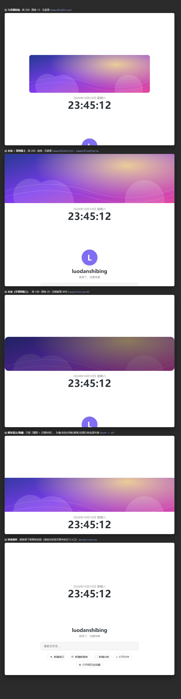

# Simple Home Tab

[English](#english) · [简体中文](#简体中文)

---

## English

A **lightweight new-tab home page** for Obsidian: filename search, a custom page name and avatar, a **banner image**, your recent files, and a live clock. Every block can be hidden individually. Built to stay out of the way — no vault scanning at startup.



### Why

Home-page plugins in the community store tend to be heavy: statistics cards, pinned notes, bookmarks, background galleries, footer quotes, a trash bin. If all you want is a clean start page, that is a lot of machinery.

This plugin does seven things and nothing else:

| Feature | Detail |
|---|---|
| **Search** | Search by file name or path, results appear as you type (120 ms debounce). The file-name index is built **the first time you search**, then cached. Hide the search box and the index is never built at all. |
| **Page name & avatar** | Any title; the avatar can be an image URL or a path inside your vault. Leave it empty to show the first character of the title. |
| **Banner image** | A picture across the top of the page — width, height, corner radius, fit, alignment, darkening, spacing and shadow are all adjustable. |
| **Recent files** | Uses Obsidian's own "last opened files" list. 1–20 rows, with relative times. |
| **Clock** | Date and time at the top; a single 1-second interval that updates one text node. Hidden = no interval at all. |
| **Quick actions** | A row of buttons under the search box that invoke Obsidian's own commands: new note, new database (Bases), new canvas, open file (quick switcher), open web browser. A button whose command cannot be found hides itself. |
| **Block switches** | On/off for every block above (banner, clock, avatar, title, greeting, search, recent files). A hidden block creates no DOM, no timer and no index. |

Every empty tab is replaced by this home page automatically.

### Banner

| Setting | What it does |
|---|---|
| Show banner | On/off |
| Banner image | An image URL, or a path inside the vault. Empty = nothing is rendered. |
| Width | **Same as page** (aligns with the 640px content column) or **Full width** (edge to edge) |
| Height | 80–600 px |
| Corner radius | 0–40 px |
| Image fit | Crop to fill (`cover`) or show the whole image (`contain`) |
| Image alignment | Which part survives the crop: center / top / bottom |
| Darkening | 0–70 % black overlay, useful when the image is too bright |
| Gap below | 0–60 px |
| Shadow | Soft drop shadow |
| Flush to top | With *Full width*: removes the page's top padding for a true full-bleed hero |

The banner is a single `` plus CSS variables. It does not read files, does not scan the vault, and adds no timers.

### Install (manual)

1. Close Obsidian.
2. Create `<your vault>/.obsidian/plugins/simple-home-tab/`.
3. Put `main.js`, `manifest.json`, `styles.css` and `versions.json` in that folder.
4. Reopen Obsidian.
5. *Settings → Community plugins* → enable **Simple Home Tab**.

If the "trust author" dialog appears, accept it — the plugin runs entirely locally, makes no network requests and uploads nothing.

### Settings

*Settings → Community plugins → Simple Home Tab → ⚙*

| Section | Items |
|---|---|
| Page header | Show clock · Show avatar + avatar path · Show title + title text · Show greeting |
| Banner | Show banner · image · width · height · corner radius · fit · alignment · darkening · gap · shadow · flush to top |
| Search | Show search box |
| Quick actions | Show the quick-action row; the setting also lists the command id each button resolved to |
| Recent files | Show recent files · number of rows (1–20) |
| About | What the plugin reads (and what it never touches) |

### Why it stays fast

- **No scanning at startup** — the vault is not traversed, nothing is indexed eagerly.
- **Recent files** come from Obsidian's built-in cache (`getLastOpenFiles()`).
- **The search index** is built once, lazily, on your first search, and invalidated when files are created, deleted or renamed.
- **Hidden blocks cost nothing** — no DOM, no timer, no index.
- The clock is one interval updating a single text node.
- No third-party dependencies. The whole plugin is ~25 KB.

### Development

`main.js` **is** the source and the artifact — plain JavaScript, no bundler, no build step. Read the file header: it documents the four design rules (no scanning at startup, hidden means not running, theme variables only, single file).

```
simple-home-tab/
├── main.js              the plugin  (§1 constants · §2 pure functions · §3 plugin · §4 view · §5 settings)
├── manifest.json
├── styles.css
├── versions.json
├── README.md
├── assets/preview.png
└── tools/
    ├── test.mjs         node tools/test.mjs    — unit tests for §2 pure functions
    ├── preview.html     visual preview of the banner and block switches
    ├── preview.svg      sample banner image
    ├── shot-preview.ps1 headless-Edge screenshot of preview.html (needs Windows + Edge)
    ├── deploy.ps1       copy the plugin into a vault (optionally enable it)
    └── deploy.bat       double-click wrapper
```

```bash
node tools/test.mjs                          # unit tests (no Obsidian needed)
powershell -File tools/deploy.ps1 -Vault "E:\Enotes" -Enable   # install into a vault
```

All the logic that can be tested without Obsidian lives in the pure functions at the top of `main.js` (`greeting`, `formatClock`, `formatDate`, `relTime`, `searchFiles`, `buildNameIndex`, `resolveImageUrl`, `bannerVars`, `bannerClasses`, `normalizeSettings`, `clampNumber`), exported under `module.exports.__test`.

### Compatibility

- Desktop and mobile (`isDesktopOnly: false`); minimum Obsidian version 1.5.0.
- Light and dark themes are handled automatically — all colours come from Obsidian's CSS variables.

### License

MIT — see [LICENSE](LICENSE).

---

## 简体中文

给 Obsidian 用的**极简新标签页**：文件名搜索、自定义页面名称与头像、**题图**、近期文档、当前日期时间。**每个模块都能单独隐藏**。启动阶段不碰 vault，尽量不拖慢 Obsidian。


### 为什么再做一个

社区里的首页插件普遍偏重：统计卡片、置顶笔记、书签、背景图库、页脚金句、回收站……如果你只是想要一个干净的起始页，这些机构本身就成了负担。

本插件只做七件事：

| 功能 | 说明 |
|---|---|
| **搜索** | 按文件名或路径搜索，输入即出结果（120ms 防抖）。文件名索引**在你第一次搜索时**才构建，之后缓存复用；把搜索框关掉，索引根本不会被建。 |
| **页面名称与头像** | 标题随意填；头像可以用网络图片 URL，也可以是库内图片路径。留空则显示标题首字。 |
| **题图** | 页面最上方的一张图 —— 宽度、高度、圆角、填充方式、对齐、压暗、间距、阴影都可调。 |
| **近期文档** | 用 Obsidian 自己的"最近打开"列表，1–20 条，带相对时间。 |
| **日期时间** | 顶部实时时钟；一个每秒的定时器，只改一个文本节点。隐藏后定时器根本不启动。 |
| **快速操作** | 搜索框下面一排按钮，直接调用 Obsidian 自己的命令：新建笔记 / 新建数据库 / 新建白板 / 打开文件 / 打开网页浏览器。解析不到命令的按钮会自动隐藏（设置页会列出解析结果）。 |
| **模块开关** | 上面每一个模块都能单独显示/隐藏（题图 / 时钟 / 头像 / 名称 / 问候语 / 搜索 / 近期文档）。隐藏的模块不产生 DOM、不跑定时器、不建索引。 |

新标签页（空标签）会自动替换成这个首页。

### 题图

| 设置项 | 作用 |
|---|---|
| 显示题图 | 开 / 关 |
| 题图图片 | 网络图片 URL，或库内图片路径。留空 = 不渲染任何东西 |
| 宽度 | **与页面同宽**（和 640px 内容列对齐）或 **全宽**（铺满整个视图） |
| 高度 | 80–600 px |
| 圆角 | 0–40 px |
| 图片填充 | 裁切铺满（`cover`）或完整显示（`contain`） |
| 图片对齐 | 裁切时保留哪一部分：居中 / 顶部 / 底部 |
| 压暗遮罩 | 0–70% 黑色覆盖层，图片太亮时用 |
| 与下方内容间距 | 0–60 px |
| 阴影 | 柔和投影 |
| 顶到最上 | 配合「全宽」：去掉页面顶部留白，做成真正的通栏题图 |

题图就是**一个 `` + 几个 CSS 变量**：不读文件、不扫描库、不新增定时器。

### 安装（手动）

1. 关闭 Obsidian；
2. 在库里创建文件夹 `<你的库>/.obsidian/plugins/simple-home-tab/`；
3. 把 `main.js`、`manifest.json`、`styles.css`、`versions.json` 四个文件放进去；
4. 重新打开 Obsidian；
5. 设置 → 第三方插件 → 启用 **Simple Home Tab**。

若弹出"信任作者"对话框，点信任即可 —— 本插件完全本地运行，不联网、不上传任何数据。

也可以用仓库里的脚本一键装进指定库：

```powershell
powershell -NoProfile -ExecutionPolicy Bypass -File tools\deploy.ps1 -Vault "E:\Enotes" -Enable
```

### 设置项

*设置 → 第三方插件 → Simple Home Tab → ⚙*

| 分组 | 项目 |
|---|---|
| 页面头部 | 显示日期时间 · 显示头像 + 头像路径 · 显示页面名称 + 名称 · 显示问候语 |
| 题图 | 显示题图 · 图片 · 宽度 · 高度 · 圆角 · 填充 · 对齐 · 压暗 · 间距 · 阴影 · 顶到最上 |
| 搜索 | 显示搜索框 |
| 快速操作 | 显示搜索框下面那排按钮；下面是每个按钮实际用到的命令 id |
| 近期文档 | 显示近期文档 · 显示条数（1–20） |
| 关于 | 本插件读什么、绝不碰什么 |

### 为什么"快"

- **启动零扫描**：不遍历 vault、不做任何预索引；
- **近期文档**用 Obsidian 内置缓存（`getLastOpenFiles()`）；
- **文件名索引**首次搜索时才构建一次，并在文件新建/删除/重命名时失效重建；
- **隐藏的模块不花任何代价**：不建 DOM、不跑定时器、不建索引；
- 时钟只有一个每秒定时器，只改一个文本节点；
- 无第三方依赖，整个插件约 25 KB。

### 开发与维护

`main.js` **既是源码也是产物** —— 普通 JavaScript，没有打包步骤、没有构建工具。文件头写明了四条设计红线（启动零扫描 / 隐藏即不跑 / 只用主题变量 / 单文件无构建），改动前先读它。

```
simple-home-tab/
├── main.js              插件本体（§1 常量 · §2 纯函数 · §3 插件 · §4 视图 · §5 设置页）
├── manifest.json
├── styles.css
├── versions.json
├── README.md
├── assets/preview.png
└── tools/
    ├── test.mjs         node tools/test.mjs —— §2 纯函数的单测
    ├── preview.html     题图与模块开关的视觉预览页
    ├── preview.svg      示例题图
    ├── shot-preview.ps1 用无头 Edge 截 preview.html（Windows + Edge）
    ├── deploy.ps1       复制进指定库（可选顺便启用）
    └── deploy.bat       双击用
```

```bash
node tools/test.mjs                                            # 单测（不需要 Obsidian）
powershell -File tools\deploy.ps1 -Vault "E:\Enotes" -Enable    # 装进指定库
```

所有"不依赖 Obsidian 就能测"的逻辑都放在 `main.js` 顶部的纯函数里（`greeting` / `formatClock` / `formatDate` / `relTime` / `searchFiles` / `buildNameIndex` / `resolveImageUrl` / `bannerVars` / `bannerClasses` / `normalizeSettings` / `clampNumber`），通过 `module.exports.__test` 导出给单测使用。

### 兼容性

- 桌面端与移动端都可（`isDesktopOnly: false`），最低 Obsidian 1.5.0；
- 亮/暗主题自动适配 —— 所有颜色取自 Obsidian 的 CSS 变量。

### 许可证

MIT，见 [LICENSE](LICENSE)。
